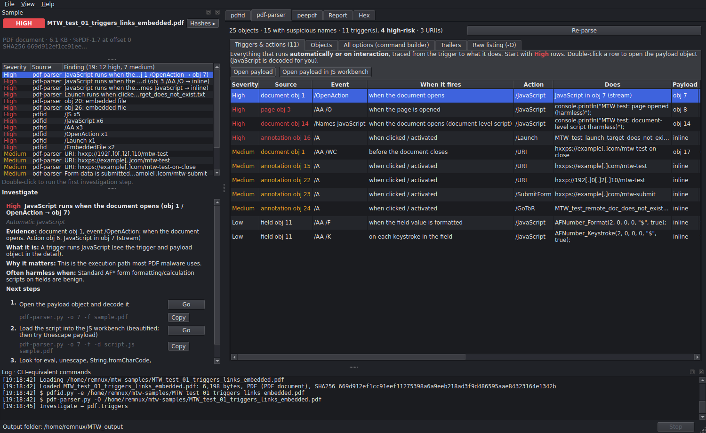
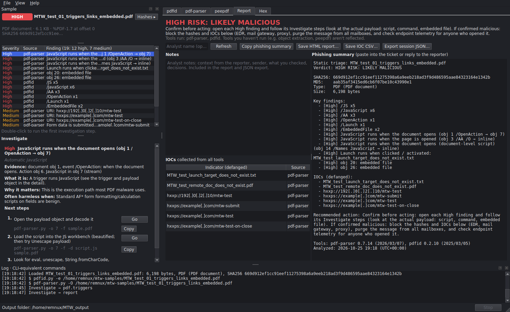
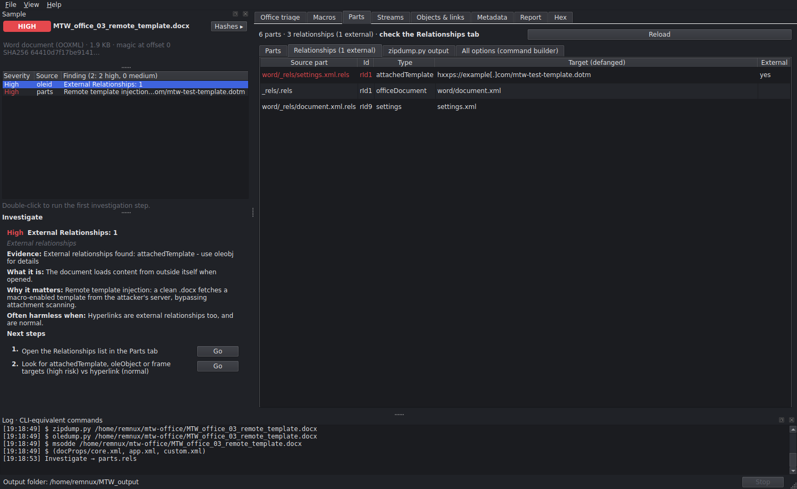

# Maldoc Triage Workbench

[](https://github.com/MrFantastic/maldoc-triage-workbench/actions/workflows/tests.yml)
[](https://github.com/MrFantastic/maldoc-triage-workbench/releases/latest)
[](LICENSE)

A guided, safety-hardened desktop front-end for the REMnux maldoc tools, for
deciding whether a single PDF or Office document is malicious. It drives Didier
Stevens' pdfid, pdf-parser, oledump, zipdump and rtfdump; Decalage's oletools;
XLMMacroDeobfuscator; msoffcrypto-tool; and peepdf. You drop in a file, the app
identifies its type from its bytes, runs the read-only analyses in isolated
background processes, and collects every finding and IOC in one place, with an
explanation and next steps for each one.

> **Warning: this tool handles live malware.** Run it only inside an isolated
> analysis VM (REMnux or similar), never on a production machine. It is provided
> as-is, with no warranty (see [LICENSE](LICENSE)).



<details>
<summary><b>More screenshots</b></summary>

**Report tab:** verdict, a phishing summary to paste into a ticket, and every IOC, defanged.



**Office:** remote template injection found in a harmless `.docx` (Parts → Relationships).



</details>

<sub>Screenshots: REMnux edition on REMnux, using the harmless files from `tests/samples/`.</sub>

### Why use it instead of running the tools yourself?

- **One place, one verdict.** Every relevant tool runs on load; findings from all of them are
  rated, correlated (e.g. standard Acrobat form scripts aren't flagged as malicious) and
  rolled into a risk verdict, with the IOCs collected and defanged.
- **It teaches the workflow.** Each finding explains what it is, when it's harmless, and the
  next steps, each with a button that does it and the equivalent command line to copy.
- **Built to be safe with hostile files.** Every parser runs in its own time- and memory-limited
  process, nothing from the sample is executed, and a tool that can't run makes the verdict
  INCOMPLETE rather than "clean". See [Safety model](#safety-model).

**Status: beta.** Developed and tested by one person, with harmless test files, on Windows
and on REMnux (noble, October 2026 release) with REMnux's own tools. Real-world use is
still limited, so treat its verdict as triage, not a final answer, and please report
false positives and negatives (see [Contributing](#contributing)).

## Download

Get the latest version from the **[Releases page](https://github.com/MrFantastic/maldoc-triage-workbench/releases/latest)**.
No git needed; pick the file for your machine:

| Your machine | Download | Then |
|---|---|---|
| **REMnux VM** | `maldoc-triage-workbench-<version>-remnux.zip` | `unzip` it, `cd maldoc-triage-workbench`, then `./install.sh` and `./start.sh` |
| **Windows** | `maldoc-triage-workbench-<version>-standard.zip` | Extract it, double-click `install.bat`, then `start.bat` |
| **Other Linux** (no REMnux tools) | `maldoc-triage-workbench-<version>-standard.zip` | `./install.sh`, then `./start.sh` |

`SHA256SUMS.txt` on the same page lists each zip's SHA-256. Check it before copying a
download into your analysis VM: `sha256sum -c SHA256SUMS.txt --ignore-missing`.

Cloned the repository instead? On REMnux, `./install.sh` notices and offers to set up the
REMnux edition.

## Design philosophy

The Workbench is for **one-off analysis: deciding whether a single file is
malicious**. It is not a case-triage or record-management system, so there are
no case trees, saved cases or case folders. It favors getting a trustworthy
answer about one file quickly and safely: every parser that reads the sample is
isolated, nothing from the sample is ever executed, and when a tool can't run
the verdict says INCOMPLETE instead of "clean".

## Tabs by file type

| File type | Tabs |
|---|---|
| **PDF** | pdfid · pdf-parser · peepdf (+ JS workbench) · Report · Hex |
| **OLE2** (doc/xls/ppt/msg) | Office triage · Macros · Streams · Objects & links · Metadata · Report · Hex |
| **OOXML** (docx/docm/xlsx/xlsm/xlsb/pptx…) | Office triage · Macros · Parts · Streams · Objects & links · Metadata · Report · Hex |
| **RTF** | Office triage · Objects & links (rtfobj, rtfdump) · Report · Hex |
| **MHT / Word XML / SLK** | Office triage · Macros · Report · Hex |

| Tab | Tools | What you get |
|---|---|---|
| pdfid | pdfid.py | Keyword triage, every option, plugins, disarmed copy |
| pdf-parser | pdf-parser.py | Object explorer with suspicious-name flags, references both ways, stream decoding (filters applied by pdf-parser), save / analyze stream, search presets, free-form console, trailers |
| peepdf | peepdf | JSON overview (versions, suspicious elements, CVE hits), scripted console (`info ; tree ; object 5`) |
| JS workbench | built-in | Beautify, decode `%u`/`\x`/`fromCharCode` payloads, URL extraction, analyze decoded bytes. Never executes JS |
| Office triage | oleid, mraptor | Indicator table, A/W/X verdict |
| Macros | olevba, pcodedmp, XLMMacroDeobfuscator, msoffcrypto-tool | Module browser with highlighting, analysis table, IOCs, revealed source, XLM emulation, VBA stomping and p-code, decryption |
| Parts | zipfile, zipdump.py | Every package part, external relationships (template injection), part content, analyze part as new sample |
| Streams | oledump.py, olemap, oledir | Stream list with M/O flags, raw / VBA / strings / hexdump / plugin views, analyze stream as new sample |
| Objects & links | oleobj, rtfobj, msodde, rtfdump.py | Extract embedded objects (renamed `.bin`), flag executables, DDE fields |
| Metadata | olefile (olemeta/oletimes), docProps | Author, last saved by, timestamps, tampering hints |
| Report | built-in | Notes, verdict and recommended action, phishing summary to paste into a ticket, HTML report, IOC CSV, JSON |

## Guided investigation

The app is built to teach the workflow, not just print a verdict.

- **Investigate panel.** Select any finding to see what it is, why attackers use
  it, when it's usually harmless, and numbered next steps. Each step has a **Go**
  button that does it in the GUI and the equivalent command line, with a **Copy**
  button. Double-click a finding to run its first step.
- **Triggers & actions (PDF).** Every `/OpenAction`, `/AA` event and link
  action is traced to what it does: "page obj 3 → when the page is opened →
  JavaScript in obj 5 → then Launch cmd.exe". Standard Acrobat form scripts
  (AFNumber_Format, AFSimple_Calculate…) are recognized as benign. Double-click
  a row to open the payload, decoded.
- **Clickable references.** In the PDF dictionary view, every `N 0 R` is a link.
  "Referenced by" shows who triggers an object.
- **All options (command builder) in every tool tab.** The form is generated
  from the installed tool's own `-h`, so every flag is there, with plain-English
  explanations for the common ones, a live command preview, recipes, the tool's
  manual, and output in the GUI.
- **Context-aware severity.** `/AA`, `/OpenAction` and `/AcroForm` alone are
  common in legitimate forms. They're only rated High when the PDF also contains
  JavaScript or `/Launch`.

Any stream, part, object or decoded payload can be opened as a child sample,
with its parent recorded.

## Editions

There are two packages, built from the same code:

- **Standard edition** (`…-standard.zip`), for Windows or Linux machines that don't have
  the tools: its installer downloads Didier Stevens' tools into `vendor/` and installs
  oletools, peepdf and the rest. Instructions below.
- **REMnux edition** (`…-remnux.zip`), for a REMnux VM: it uses the tools REMnux already
  has (PATH, `/usr/local/bin`), never downloads any, and ignores any `vendor/` folder.
  Its own README explains the two commands it needs (`./install.sh`, `./start.sh`).

Help → Tool status shows which edition is running and where each tool was found.

## Install (standard edition)

### Windows, quick way

1. Install Python from python.org (3.12 or newer recommended; 3.9 is the minimum). On the
   first installer screen, tick **"Add python.exe to PATH"**.
2. Extract this folder somewhere permanent, e.g. `C:\Tools\maldoc-triage-workbench`.
3. Double-click **`install.bat`** (one time, needs internet access to github.com and pypi.org).
   It creates a private Python environment (`.venv`) in the folder, the same as `install.sh`.
4. Double-click **`start.bat`** to run the app. You can also drag a sample onto `start.bat`.

### Linux, quick way

```bash
./install.sh     # one time: creates .venv, downloads the tools, installs the packages
./start.sh       # or: ./start.sh suspicious.pdf
```

If the window doesn't open under an X11 session, install Qt's missing library:
`sudo apt install libxcb-cursor0` (Wayland desktops don't need it).

### Manual

Python 3.9 or newer (3.12+ recommended) on Windows or Linux.

```bash
pip install -r requirements.txt          # PySide6, oletools, msoffcrypto-tool
python setup_vendor.py                   # Didier Stevens' tools + plugins -> ./vendor
python run.py                            # or: python run.py suspicious.pdf
```

Optional extras:

```bash
pip install -r requirements-xlm.txt      # Excel 4.0 macro emulation
python setup_vendor.py --peepdf         # peepdf overview + console (GPLv3), skips its JS engine
pip install -r requirements-safety.txt   # pikepdf (Decrypt PDF) and defusedxml
```

Pinning and verifying the vendored tools:

```bash
python setup_vendor.py --ref <commit>    # fetch a specific DidierStevensSuite commit or tag
python setup_vendor.py --record          # re-record vendor/manifest.json after copying tools in
```

Every fetch records each tool's SHA-256 in `vendor/manifest.json` and lists any
file whose hash changed since the previous fetch. The app re-checks the hashes at
startup and warns if a tool script changed; **Help → Tool status** shows
`[verified]` or `[CHANGED]` per tool. This proves the scripts are the ones that
were fetched, not that the fetch was genuine: pin a commit with `--ref` and
compare the hashes with a known-good copy (e.g. REMnux) to close that gap.

- **REMnux:** use the REMnux edition instead: it uses REMnux's own tools and downloads nothing.
- **Offline:** `python setup_vendor.py --copy-from C:\path\to\DidierStevensSuite`
- **Custom locations:** set `MTW_PDFID`, `MTW_PDF_PARSER`, `MTW_OLEDUMP`, `MTW_ZIPDUMP`,
  `MTW_RTFDUMP`, or `MTW_PEEPDF` to a script path.
- **Help → Tool status** shows what was found.

If you're updating from an earlier version, re-run `python setup_vendor.py`.
[CHANGELOG.md](CHANGELOG.md) lists what changed in each version.

## Typical phishing workflow

1. Drop the attachment on the window. Triage, macro analysis, streams, parts,
   DDE and metadata run automatically.
2. Read the risk badge and the findings list. Double-click to see evidence.
3. If it's encrypted, use Macros → Decrypt (Excel's default password is tried first),
   or for a PDF, **Decrypt PDF** in the pdf-parser tab. The readable copy opens as a
   new sample and every tool re-runs on it.
4. If there are embedded objects, use Objects & links → Extract, then double-click
   one to analyze it.
5. Go to Report: add notes, then **Copy phishing summary** into the ticket. Save the
   HTML report and the IOC CSV for blocking (EDR, mail gateway, proxy).
6. To keep what you extracted, use **File → Export artifacts**: one zip encrypted
   with the password `infected`, plus a manifest of SHA-256 hashes. The app can then
   delete the loose `.bin` copies.

## Safety model

- Samples are opened read-only and never rendered or executed. Macro and JS code
  is shown as text.
- **Nothing from the sample runs.** The JavaScript engines peepdf can use
  (STPyV8 / PyV8) are made unimportable for every tool the app starts, so even
  where one is installed (as on some REMnux builds) no tool evaluates the
  sample's JavaScript. peepdf console commands that run or emulate code
  (`js_eval`, `js_analyse`, `js_vars`, `sctest`) are refused. The only emulation
  is XLM formulas, by XLMMacroDeobfuscator, when you click Emulate.
- **Every parser that reads the sample runs in its own process** with a time
  limit, an output cap and (on Linux) a 3 GB memory cap: the external tools, and
  also the in-app parsers (oletools, olefile, msoffcrypto, pdfid, zip/XML
  parsing, PDF decryption, the JS beautifier). A file crafted to hang or crash a
  parser can't take the app down, and the failure is reported as suspicious.
  **Stop** in the status bar kills the current file's tools.
- Opening another file drops every pending result from the previous one and
  kills its tool processes, so results can't land on the wrong sample.
- OOXML parts are read within a 512 MB total / 64 MB per-part budget (20,000
  parts max); zip bombs and parts with DTD or entity declarations are flagged
  and not parsed.
- The original file is re-hashed on close, and the app warns if it changed.
- Everything written out (streams, parts, objects, decrypted copies, carved
  bytes, payloads) gets a `.bin` suffix in the output folder (default
  `~/MTW_output`). File → Export artifacts packs them into a zip encrypted with
  the password `infected` (ZipCrypto, which every unzip tool and sandbox reads;
  its job is to keep AV and double-clicks away, not secrecy).
- URLs and IPs are defanged in tables, findings, and reports. Text from the
  sample is HTML-escaped wherever it's shown, and CSV exports are guarded
  against spreadsheet formula injection.
- Vendored tool scripts are hash-checked at startup (see Install).
- App errors are written to `~/MTW_output/logs/` and shown in the log panel,
  even when started with `pythonw`.
- There's no network access, except a tool download you start, or peepdf's
  `vtcheck` if you type it, which sends the hash only.
- Run inside REMnux or an isolated VM. On Windows, add an exclusion for the
  analysis folder or Defender will quarantine samples.

## When the tools are updated

The app reads several tools by parsing their printed output, so a new tool version
that changes its format must not quietly hide findings:

- **Tool versions** are shown in Help → Tool status (with where each tool was found
  and its hash status), logged at startup, and recorded in the report, the phishing
  summary and the session export, so you know which versions produced a result.
- **Nothing recognized:** if a tool ran but none of its output was in a shape the app
  knows (pdfid, pdf-parser, oledump, msodde, peepdf), the tool is treated as failed and
  the verdict says INCOMPLETE rather than "nothing found".
- **Part not recognized:** if some of the output wasn't recognized (an unknown line or
  header field, a keyword pdfid reports that the app has no rating for), an Info finding
  says so, with the tool version and the first unrecognized lines, even when other
  findings exist. The verdict notes it, and a Low verdict becomes "(UNVERIFIED)". The
  form-script downgrade is also switched off while pdf-parser's output is partial.
- Python-version notices that Didier Stevens' tools print are recognized and ignored.

If an update causes these notes, pin the previous version with
`python setup_vendor.py --ref <commit>` until the app is updated.

## Standalone build

```bash
pip install pyinstaller
python setup_vendor.py
python build.py        # -> dist/MaldocTriageWorkbench/
```

Build on each OS you need. The executable re-launches itself as the isolated
worker and to run the bundled tools, so timeouts and process isolation work
without Python installed.

## Contributing

Bug reports, false positives / negatives and pull requests are welcome. See
[CONTRIBUTING.md](CONTRIBUTING.md) for how to report a result without sharing malware, the code
layout, running the tests and making a release. Security issues: [SECURITY.md](SECURITY.md).

## License

Maldoc Triage Workbench is released under the [MIT License](LICENSE).

It doesn't include any of the analysis tools: they are downloaded or found at
install time and run as separate programs, each under its own license.

| Tool | License | How the app gets it |
|---|---|---|
| Didier Stevens' pdfid, pdf-parser, oledump, zipdump, rtfdump | Public domain | Downloaded by `setup_vendor.py` (standard edition), or REMnux's copies |
| oletools | BSD-2-Clause | pip |
| msoffcrypto-tool | MIT | pip |
| XLMMacroDeobfuscator | Apache-2.0 | pip (optional) |
| peepdf-3 | GPLv3 | pip, optional, installed separately; never bundled or imported |
| PySide6 (Qt) | LGPLv3 | pip |
| pikepdf / defusedxml | MPL-2.0 / PSF | pip (optional) |
